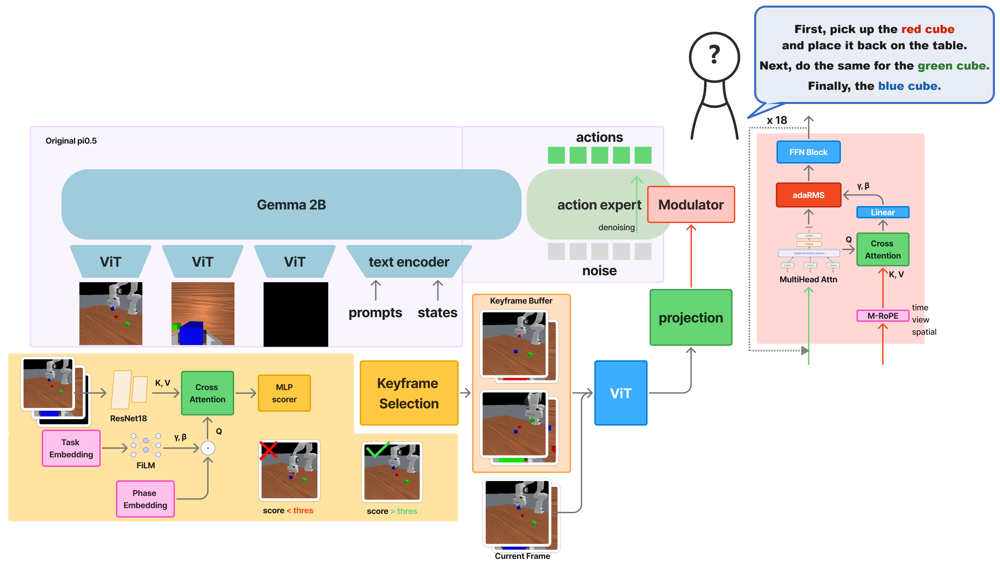

# KF_pi0.5

KF_pi0.5 extends [OpenPI’s π₀.₅](https://github.com/Physical-Intelligence/openpi) with light-weighted keyframe memory and modulator input for robot manipulation.

## Model Framework



**Keyframe Scorer.** The scorer uses ResNet18 to encode candidate frames and combines task and phase embeddings through FiLM and cross-attention. An MLP scores each frame, and frames above the threshold enter the keyframe buffer. This repository uses precomputed keyframe annotations for training and client-supplied history for inference.

**Modulator.** SigLIP encodes the buffered frames and the current frame. The resulting tokens are combined with time, view, and spatial position embeddings and projected into the action expert’s hidden space. Action tokens attend to this memory to produce scale and shift parameters that modulate RMSNorm before each feed-forward block.

## Usage

### Install

Use Linux with a CUDA-capable NVIDIA GPU, Git LFS, and [uv](https://docs.astral.sh/uv/getting-started/installation/). The upstream checkout provides the Python 3.11 environment and `openpi-client`.

```bash
git clone https://github.com/FN8211/KF_pi0.5.git
git clone https://github.com/Physical-Intelligence/openpi.git openpi-upstream
git -C openpi-upstream checkout 215abfb217dbac7d5f1273282331b9b1866c0479
(cd openpi-upstream && GIT_LFS_SKIP_SMUDGE=1 uv sync --locked --python 3.11)
source openpi-upstream/.venv/bin/activate
cd KF_pi0.5
export PYTHONPATH="$PWD/src${PYTHONPATH:+:$PYTHONPATH}"
```

### Train

1. Put your LeRobot v2.1 ManiSkill dataset at `$HF_LEROBOT_HOME/local/maniskill_dataset_push`. The loader expects base and wrist video streams named `image` and `wrist_image`.
2. Add `meta/keyframes.json` to the dataset. Map each episode ID to its zero-based keyframe indices, for example `{"0": [0, 18, 42]}`.
3. In the `pi05_maniskill_modular` entry in [`config.py`](src/openpi/training/config.py), set `data.dataset_root`, `data.keyframes_path`, and `weight_loader.params_path` to local paths. Use the Orbax `params/` directory from the [upstream π₀.₅ LIBERO checkpoint](https://github.com/Physical-Intelligence/openpi#model-checkpoints) to initialize training.

```bash
export HF_LEROBOT_HOME="$PWD/datasets"
python scripts/compute_norm_stats.py pi05_maniskill_modular
python scripts/train.py pi05_maniskill_modular --exp-name kf_modular --no-wandb-enabled
```

### Run inference

Start the policy server with a trained checkpoint. Replace `2999` with your saved step. The checkpoint should contain `params/` and `assets/`, and the configured keyframe file must still be readable.

```bash
python scripts/serve_policy.py --port 8000 policy:checkpoint \
  --policy.config pi05_maniskill_modular \
  --policy.dir checkpoints/pi05_maniskill_modular/kf_modular/2999
```

Connect with `openpi_client.websocket_client_policy.WebsocketClientPolicy` on port `8000`. Pass the following fields to `client.infer(observation)`.

| Field | Value |
| --- | --- |
| `observation/image`, `observation/wrist_image` | Current RGB images as `uint8` arrays |
| `observation/state`, `prompt` | Robot state as a `float32` array and a task prompt |
| `history_image` | `history_base` and `history_wrist`, each a `uint8` array of shape `[6, H, W, 3]` with the current frame last |
| `history_mask`, `history_timesteps` | Six padding flags (`True` for padding) and six episode frame indices (`0` for padding) |
| `phase_id` | Use `0` for Modular inference |

The default configuration returns `actions` with shape `[10, 7]`.
